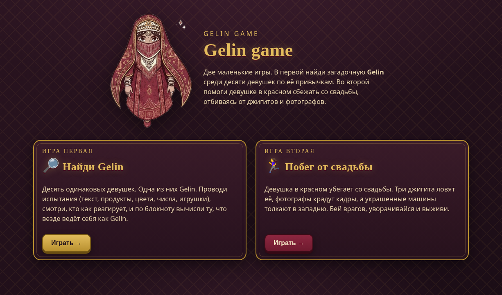
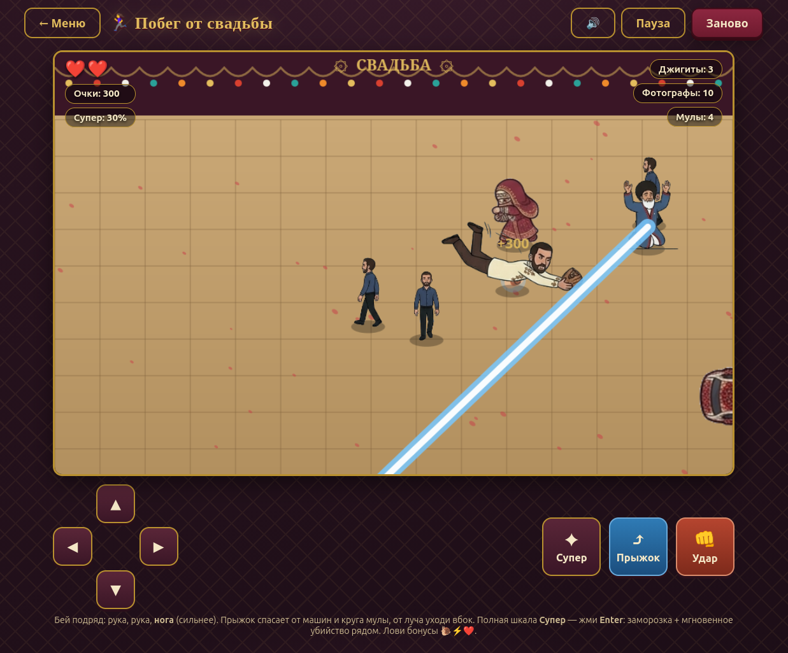
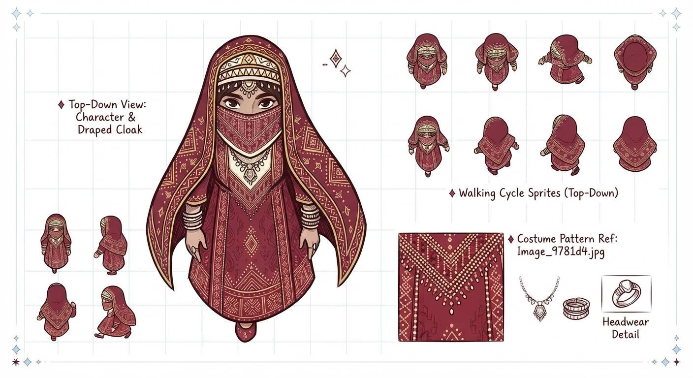
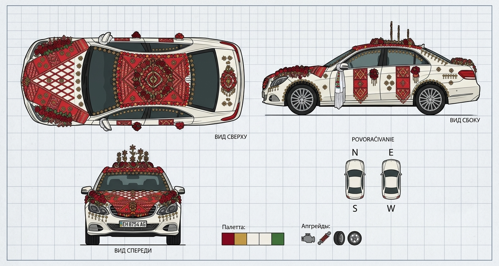

# Gelin game

Небольшой веб-проект из двух мини-игр на восточную/свадебную тему. Чистый HTML5 Canvas и ванильный JavaScript, без игровых движков и сборщиков. Всё работает офлайн: открой `index.html` и играй.



## Что внутри

Главное меню (`index.html`) ведёт в две независимые игры.

### 1. Найди Gelin (`game1.html`)

Головоломка на наблюдение. Перед тобой 10 одинаковых девушек в парандже, одна из них Gelin, но кто именно, заранее неизвестно (приметы не показываются).

Проводишь 5 испытаний, и девушки реагируют по-своему:

- **Текст**: пишешь слово или число, кто-то смеётся (есть смешные туркменские слова);
- **Продукты**: ставишь еду на стол, каждая берёт что любит;
- **Цвета**: выкладываешь цвета, каждая выбирает свои;
- **Числа**: загадываешь до трёх чисел;
- **Игрушки**: предлагаешь плюшевые игрушки.

После каждого испытания блокнот ставит девушкам `✓` (ведёт себя как Gelin) или `✗`. Твоя задача: найти ту, у кого везде `✓`, и назвать её. На обвинение даётся 2 попытки. Решение всегда единственное.

### 2. Побег от свадьбы (`game2.html`)

Экшн сверху-сбоку. Играешь за девушку в красном, которая сбегает со свадьбы. Нужно зачистить всех врагов и выжить.



Враги и помехи:

- **Джигиты** (3): быстро догоняют и ловят, вблизи делают рывок. 3 удара.
- **Фотографы** (10, не больше 3 на экране): наводят видоискатель и снимают (минус жизнь), уходи из кадра или бей. 2 удара.
- **Мулы** (4, до 3 сразу): медленные, читают молитву. Пускают прямой **луч** в твою сторону (уходи вбок от линии) или садятся и делают **круг** (перепрыгни). Со временем устают и садятся отдыхать.
- **Машины**: сигналят перед выездом и толкают в западню, уворачивайся или прыгай.

Возможности героини:

- комбо ударов: **рука, рука, нога** (нога сильнее);
- **прыжок** спасает от машин и круга мулы;
- **супер-удар** на `Enter`: когда шкала полна, замораживает всех врагов и мгновенно убивает тех, кто рядом;
- с врагов падают **бонусы**: 🐌 замедление, ⚡ быстрые удары, ❤️ жизнь;
- сердечки на поле восстанавливают жизнь.

**Управление**: `WASD` / стрелки движение, `J` / `Пробел` удар, `K` / `Shift` прыжок, `Enter` супер. Есть и экранные кнопки для мыши/сенсора.

## Арт и раскадровки

Персонажи и объекты нарисованы как концепт-листы (раскадровки), из которых скриптами вырезаны игровые спрайты.

| Дизайн героини | Свадебная машина |
|:---:|:---:|
|  |  |

## Запуск

Проще всего открыть `index.html` в браузере. Если спрайты не грузятся из `file://`, запусти локальный сервер:

```bash
python3 -m http.server
```

и открой `http://localhost:8000`.

## Структура

```
index.html            меню
game1.html, game2.html игры
css/                  стили (общий + по игре)
js/game1.js, game2.js логика игр
assets/sprites/       спрайты персонажей (вырезаны из раскадровок)
assets/products/      картинки продуктов для игры 1
assets/raw/           исходные листы-раскадровки
tools/                скрипты обработки картинок и headless-проверки
```

Спрайты вырезаны из концепт-листов скриптами в `tools/` (удаление фона заливкой от границ + нарезка связных компонентов на Pillow). Игровая логика покрыта headless-проверками (`tools/harness*.js`), которые гоняют игровой цикл без браузера.
